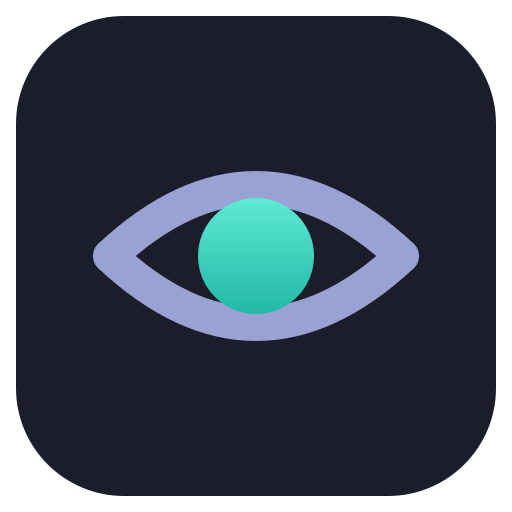

# Mirada

**A fast, folder-oriented image viewer.** Double-click a photo, look, arrow through the folder, close.

[](https://github.com/adriandeleon/Mirada/actions/workflows/ci.yml)
[](LICENSE)
[](https://openjdk.org/projects/jdk/25/)
[](https://openjfx.io/)
[](#building-it)

Java 25 + JavaFX 27.

An image viewer is the app you open a hundred times a day for three seconds each. Mirada treats the
folder as the document: open one photo and the rest of the folder is already there, in the order
you'd number it, one arrow key away. The image fills the window; the properties sidebar says
which file, where it sits in the folder, how large it is, and what took it.

<br clear="left">

**Status:** early, and unreleased. JPEG, PNG, GIF, BMP, WebP, TIFF, PSD, HEIC, AVIF and JPEG XL,
turned upright, animated where the file is. The native decoders (libjpeg-turbo, libwebp, libheif,
libjxl) are built from source and bundled; the build downloads them. Crop, turn and flip, and save
the result as a new file. See the [changelog](CHANGELOG.md).

## Installing it

Installers for Linux (x64 and arm64), macOS (Apple silicon and Intel) and Windows will be on the
[releases page](https://github.com/adriandeleon/Mirada/releases). Each registers Mirada for the image
types it opens. Until the first signed release, each platform asks once:

- **Linux** — `sudo apt install ./Mirada-<version>-linux-x64.deb` (apt fetches what it needs), or
  the `.rpm` with `dnf`. The `.tar.gz` runs from wherever it is unpacked: `bin/Mirada`.
- **macOS** — open the `.dmg` and drag Mirada to Applications. macOS refuses the first launch of an
  unnotarized app: open **System Settings → Privacy & Security**, find Mirada near the bottom, and
  choose **Open Anyway**.
- **Windows** — run the `.msi`. SmartScreen warns about an unknown publisher: **More info → Run
  anyway**.

A signed release carries `SHA256SUMS.asc` and the key that signed it, `mirada-signing-key.asc`:
`gpg --import mirada-signing-key.asc && gpg --verify SHA256SUMS.asc && sha256sum -c SHA256SUMS`
checks every download.

## Using it

Open a photo or a folder from the command line, with Ctrl+O, or by dropping it on the window.
Drag to pan a zoomed image; the wheel zooms about the pointer. Move the pointer over the image for
the previous/next and zoom controls; the header's buttons go full screen, rotate, open the
properties sidebar and the main menu.

| Key | Does |
|---|---|
| Right, Page Down, Space | Next image |
| Left, Page Up, Backspace, Shift+Space | Previous image |
| Home / End | First / last image |
| `+` / `-` | Zoom in / out |
| `0` / `1` | Fit to window / actual size (double-click toggles them) |
| Shift+arrows, Up / Down | Pan a zoomed image |
| `Z` | Keep the zoom when stepping (compare one detail across shots) |
| `R` / Shift+`R` | Rotate right / left |
| `E` | Edit: crop, turn, flip, undo (Ctrl+Z); Enter saves a copy, with its EXIF and colour profile; Escape cancels |
| F2 | Rename |
| Delete | Move to the Trash |
| F5 | Slideshow |
| `F`, F11 | Full screen |
| Escape | Leave full screen, or close |
| `I` | Properties sidebar: file, image and camera details |
| `T` | Thumbnail strip |
| Ctrl+Shift+P, F1 | Command palette: every command, by name |
| Ctrl+, | Settings: theme, panels at start, sort order, slideshow speed |
| Ctrl+? | Keyboard shortcuts |
| F12 | About |
| Ctrl+O | Open |
| Ctrl+W, Ctrl+Q | Close |

On macOS, Cmd takes Ctrl's place. The folder can be sorted by name, date or size from the context
menu or the palette.

## Building it

JDK 25 is required (the build refuses others); Oracle GraalVM 25.4 for the native image that ships.
The Maven wrapper fetches everything else, including the native codec bundle for your platform from
the project's `codecs-N` release.

```
./mvnw javafx:run                                   # an empty window
./mvnw javafx:run -Djavafx.args=/path/to/photo.jpg  # a photo and its folder
./mvnw verify                                       # tests, null checks, formatting
./mvnw clean -Pdist,native -DskipTests package      # the app as it ships, in target/dist (GraalVM)
./mvnw clean -Pdist -DskipTests package             # the JVM app, on any JDK 25
```

Add `-Dskip.installers=false` to wrap it into this platform's installers, in `target/installers`.

The native app starts in about an eighth of a second, with the first image decoding while the
window is still being built. The JVM app takes about a quarter: a jlink runtime with an AOT cache
trained by stepping through every format.

The project notes for contributors, human or not, are in [AGENTS.md](AGENTS.md).

## Licence

MIT — see [LICENSE](LICENSE). Third-party notices are in [NOTICE](NOTICE).
