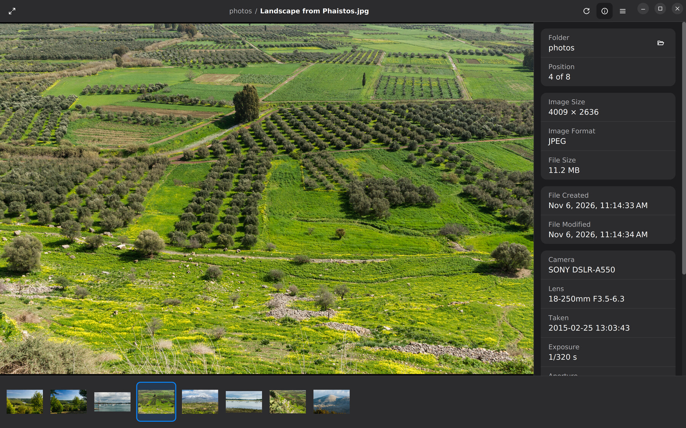

# Mirada

**A fast, folder-oriented image viewer.** Double-click a photo, look, arrow through the folder, close.

[](https://github.com/adriandeleon/Mirada/actions/workflows/ci.yml)
[](LICENSE)
[](https://openjdk.org/projects/jdk/25/)
[](https://openjfx.io/)
[](#installing-it)
[](https://mirada-project.dev/docs/)
[](https://pauta-project.dev/4.0.1/)

Java 25 + JavaFX 27. Built to [Pauta (the adl desktop apps guidelines)](https://pauta-project.dev/), edition [4.0.1](https://pauta-project.dev/4.0.1/).

An image viewer is the app you open a hundred times a day for three seconds each. Mirada treats the
folder as the document: open one photo and the rest of the folder is already there, in the order
you'd number it, one arrow key away. The image fills the window; the properties sidebar says
which file, where it sits in the folder, how large it is, and what took it.

Mirada's first window was modelled on [GNOME Image Viewer](https://apps.gnome.org/Loupe/) (Loupe):
the header bar, the controls that float over the image and fade, and the properties sidebar all
started from its design.

<br clear="left">



<sub>Photos: [Jebulon](https://commons.wikimedia.org/wiki/User:Jebulon), CC0, on Wikimedia Commons.</sub>

**The user guide is at [mirada-project.dev/docs](https://mirada-project.dev/docs/)**:
[getting started](https://mirada-project.dev/docs/getting-started),
[the keyboard](https://mirada-project.dev/docs/keyboard), [Settings](https://mirada-project.dev/docs/settings)
and the [FAQ](https://mirada-project.dev/docs/faq). What changed in each release is in the
[changelog](CHANGELOG.md).

## Highlights

- **Fast.** The packaged app shows the first image about an eighth of a second after launch, the
  first image decoding while the window is still being built; the neighbours are decoded before you
  step to them.
- **Every common format, upright.** JPEG, PNG, GIF, BMP, WebP, TIFF, PSD, HEIC, AVIF and JPEG XL,
  turned by their EXIF orientation, animated where the file is. The native decoders (libjpeg-turbo,
  libwebp, libheif, libjxl) are built from source and bundled
  ([formats](https://mirada-project.dev/docs/formats)).
- **The folder is the document.** Natural name order, or by date or size; a thumbnail strip along
  the bottom or down the side; Go to Image and Open Recent by name
  ([the folder](https://mirada-project.dev/docs/the-folder)).
- **Keyboard first, with a command palette.** Every command has a key and a name: Ctrl+Shift+P,
  Alt+X or F1 finds and runs any of them, and Ctrl+? lists every key
  ([the keyboard](https://mirada-project.dev/docs/keyboard)).
- **Crop, turn and flip**, and save the result as a new file that keeps the photo's EXIF, colour
  profile and XMP ([editing](https://mirada-project.dev/docs/editing)).
- **Bookmarks and notes** on images and folders, kept by Mirada, never written into the file.
- **Properties**: file, image and camera details in a sidebar
  ([properties](https://mirada-project.dev/docs/properties)).
- **Rename, Move to Trash, Copy, Show in Folder, a slideshow**, and full screen
  ([files](https://mirada-project.dev/docs/files), [viewing](https://mirada-project.dev/docs/viewing)).
- **Native on each platform**: a header bar on Linux, a menu bar and Finder's and Preview's keys on
  macOS, the Recycle Bin and the system's accent colour on Windows.

## Installing it

Installers for Linux (x64 and arm64), macOS (Apple silicon and Intel) and Windows are on the
[releases page](https://github.com/adriandeleon/Mirada/releases). Each registers Mirada for the image
types it opens. Until the first signed release, each platform asks once:

- **Linux** — `sudo apt install ./Mirada-<version>-linux-x64.deb` (apt fetches what it needs), or
  the `.rpm` with `dnf`. The `.AppImage` runs as it is, on any distribution with GTK 3
  (`chmod +x`, then run it); the `.tar.gz` runs from wherever it is unpacked: `bin/Mirada`.
- **macOS** — open the `.dmg` and drag Mirada to Applications. macOS refuses the first launch of an
  unnotarized app: open **System Settings → Privacy & Security**, find Mirada near the bottom, and
  choose **Open Anyway**.
- **Windows** — run the `.msi`. SmartScreen warns about an unknown publisher: **More info → Run
  anyway**.

From 0.4.0 the macOS dmg is notarized and opens without **Open Anyway**. Every release carries
`checksums_sha256.txt`, its signature `checksums_sha256.txt.asc` and the key that signed it,
`mirada-signing-key.asc` (also [`packaging/linux/signing-key.asc`](packaging/linux/signing-key.asc)):
`gpg --import mirada-signing-key.asc && gpg --verify checksums_sha256.txt.asc && sha256sum
--check --ignore-missing checksums_sha256.txt` checks a download. Each Linux file has its own `.asc`,
and every download its build provenance: `gh attestation verify <file> --repo adriandeleon/Mirada`.
0.3.0 and earlier have `SHA256SUMS` and `SHA256SUMS.asc` instead.

## Using it

Open a photo or a folder from the command line, with Ctrl+O, or by dropping it on the window; an
empty window has Open Image and Open Folder buttons. Arrow keys step through the folder, the wheel
zooms about the pointer, and dragging pans a zoomed image. On macOS, Cmd takes Ctrl's place.

Every key, and how to change the palette's, is on the website's
[keyboard page](https://mirada-project.dev/docs/keyboard); in the app, **Help → Documentation**
opens the guide, and Ctrl+? lists every key.

## Command line

```
Usage: mirada [options] [file-or-folder]

Opens an image with its folder behind it, or a folder at its first image.

Options:
  --config-dir <dir>  keep settings and bookmarks in <dir>
  --dev               keep them in ~/.mirada-dev, apart from your own
  --version           print the version, build, commit and Pauta edition, and exit
  --help              print this, and exit
  --                  what follows is a file, even if it starts with --

MIRADA_CONFIG_DIR names the config folder too; an option wins over it.
```

## Config folder

Mirada keeps two plain files, meant to be readable and mendable by hand:

| Platform | Folder |
|---|---|
| Linux | `~/.mirada` |
| macOS | `~/Library/Application Support/Mirada` |
| Windows | `%APPDATA%\Mirada` |

- `settings.properties` — the theme, the panels at start, the folder's order, the slideshow's pace,
  the palette's keys, the window's place and the recent folders. Every value is checked as it is
  read, so a bad edit cannot stop Mirada starting.
- `bookmarks.properties` — your bookmarks and notes, by path.

A file that will not read is kept beside it as `<name>.corrupt.bak`, and Mirada starts with the
defaults. `--config-dir`, `--dev` or `MIRADA_CONFIG_DIR` point Mirada at another folder, to try
something without touching your own settings.

## Building it

JDK 25 is required (the build refuses others); Oracle GraalVM 25.4 for the native image that ships.
The Maven wrapper fetches everything else, including the native codec bundle for your platform from
the project's `codecs-N` release.

```
./mvnw javafx:run                                   # an empty window
./mvnw javafx:run -Djavafx.args=/path/to/photo.jpg  # a photo and its folder
./mvnw verify                                       # tests, null checks, coverage, formatting
./mvnw clean -Pdist,native -DskipTests package      # the app as it ships, in target/dist (GraalVM)
./mvnw clean -Pdist -DskipTests package             # the JVM app, on any JDK 25
```

Add `-Dskip.installers=false` to wrap it into this platform's installers, in `target/installers`.
How the pieces fit together is in
[docs/building-and-packaging.md](docs/building-and-packaging.md).

## Contributing

[CONTRIBUTING.md](CONTRIBUTING.md) says how to build, test and open a pull request, and
[docs/](docs/README.md) how Mirada is built: its architecture, conventions, tests and the things
that will bite you. Coding agents start at [AGENTS.md](AGENTS.md). A bug report is easiest with
**About → Copy details** pasted into the
[bug report form](https://github.com/adriandeleon/Mirada/issues/new?template=bug_report.yml).

## Licence

MIT — see [LICENSE](LICENSE). Third-party notices are in [NOTICE](NOTICE).
